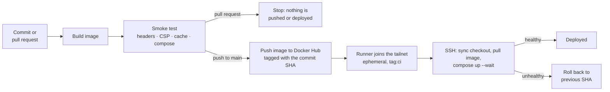

<div align="center">

```
██████╗ ███████╗██╗   ██╗ ██████╗ ██████╗ ███████╗
██╔══██╗██╔════╝██║   ██║██╔═══██╗██╔══██╗██╔════╝
██║  ██║█████╗  ██║   ██║██║   ██║██████╔╝███████╗
██║  ██║██╔══╝  ╚██╗ ██╔╝██║   ██║██╔═══╝ ╚════██║
██████╔╝███████╗ ╚████╔╝ ╚██████╔╝██║     ███████║
╚═════╝ ╚══════╝  ╚═══╝   ╚═════╝ ╚═╝     ╚══════╝
```

# Portfolio Infrastructure

### A static site that proves I can think in systems — not just tools.


[](https://github.com/element665/Website/actions/workflows/docker-image.yml)

</div>

---

## What This Is

This repository hosts the infrastructure for my personal portfolio — a site I use with real clients as a **camera and Steadicam operator**.

The site itself is simple. The infrastructure is the point.

Every decision here — from container strategy to networking model — was made the same way I'd make it in a professional engineering environment: **weighing security, cost, reliability, and maintainability against each other**, and being able to defend the outcome.

This is a career-transition project. It is also a production system I actively depend on.

---

## Architecture

```
┌─────────────────────────────────────────────────────────┐
│                    PUBLIC INTERNET                      │
└──────────────────────────┬──────────────────────────────┘
                           │ HTTPS
                           ▼
                  ┌────────────────┐
                  │   Cloudflare   │  ← CDN + DDoS protection
                  │    Tunnel      │  ← No inbound ports open to the internet
                  └───────┬────────┘
                          │ Encrypted tunnel (outbound only)
                          ▼
            ┌─────────────────────────────────┐
            │           Home Server           │  ← Private. Never directly exposed.
            │                                 │
            │  ┌───────────────────────────┐  │
            │  │       Docker Compose      │  │
            │  │                           │  │
            │  │    ┌─────────────────┐    │  │
            │  │    │   cloudflared   │    │  │  ← Opens the tunnel (outbound only)
            │  │    └────────┬────────┘    │  │
            │  │             │             │  │
            │  │             ▼             │  │
            │  │    ┌─────────────────┐    │  │
            │  │    │      NGINX      │    │  │  ← Static assets baked in
            │  │    └─────────────────┘    │  │
            │  └───────────────────────────┘  │
            └─────────────────────────────────┘
```

**Nothing on the public internet connects to the server.** The tunnel is outbound-initiated, so no inbound port is exposed to the internet. This is zero-trust networking applied at the infrastructure layer — not bolted on as an afterthought.

---

## Engineering Decisions

> These aren't just implementation choices. They reflect how I approach real-world constraints.

---

### 🔒 Zero Inbound Exposure

| Approach | Why Not |
|---|---|
| Public IP + open ports | Widens attack surface. Requires careful firewall management. |
| Reverse proxy exposed directly | Unnecessary risk for a static site. |
| **Cloudflare Tunnel** ✓ | Outbound-only connection. No public IPs. No open ports. Defense-in-depth. |

Cloudflare Tunnel means the server is **invisible to the public internet by design**, not by policy. The public side needs no firewall management — there are no inbound ports to open, watch, or forget.

---

### 🔐 Private Network Access via Tailscale

CI/CD deployment is handled over a private WireGuard-based overlay network using Tailscale, rather than exposing SSH to the public internet.

**Why this matters:**
- Port 22 is never open to the public internet
- The GitHub Actions runner joins the private network ephemerally for the duration of the deployment, then is automatically removed
- It authenticates with a Tailscale OAuth client rather than an auth key, so there is no 90-day expiry to break deployments
- The runner is a tagged node (`tag:ci`), so the tailnet ACL can limit what it is allowed to reach
- The deploy step authenticates with an SSH key, not a password
- Eliminates an entire class of brute force exposure

---

### 📦 Fully Baked Container Images

Content is copied into the image at build time. No volume mounts, no runtime file injection.

```dockerfile
# Assets baked in — not mounted at runtime
COPY --from=assemble /out/ /usr/share/nginx/html/
```

**Why this matters:**
- Every running container is built from **the exact commit CI tested**
- Rollbacks are a one-line change (the image tag in `.env`) and a `docker compose up -d` — no state to reconcile — and the deploy does it automatically if a new image fails its health check
- Deployment is deterministic and reproducible
- Eliminates an entire class of runtime configuration drift

I chose this to simulate how static content ships in real production pipelines.

---

### ⚖️ Docker Compose over Kubernetes (Intentionally)

Migrating from Kubernetes to Docker Compose was a deliberate infrastructure decision, not a step backwards.

The home server running this site has constrained resources. Kubernetes introduces significant overhead — control plane components, etcd, the scheduler, and associated memory usage — that is difficult to justify when the workload is a single NGINX container. Docker Compose provides the same declarative, reproducible deployment model with a fraction of the resource cost.

**The right tool for the right environment.** Knowing when *not* to use a technology is as important as knowing how to use it.

---

### 💰 Cost-Optimized Infrastructure

The site runs on a self-hosted home server — not a cloud instance. Operational cost is effectively zero beyond electricity and the domain name.

Real infrastructure work happens inside real budget constraints. Designing a system that is secure, automated, and maintainable without any recurring cloud spend is a deliberate exercise in resource-conscious engineering.

---

### 🛡️ Hardened and Tested, Not Just Configured

NGINX sends a strict Content-Security-Policy, HSTS, `nosniff` and frame-denial headers, and its metrics endpoint lives on an internal-only listener that is never published or tunnelled.

Configuration nobody tests tends to be wrong, so CI checks the running container: the security headers must be present on real pages, scripts and images (not just on error pages), the CSP must allow the embedded video players, cache headers must be sane, and `/stub_status` must not answer on the public port. A regression fails the build before anything is pushed.

---

### 🖼️ Smaller Images, Same Photos

Photos come straight off a phone at about 3000×4000 px, far larger than the cards that show them. A build stage downsizes and re-encodes the JPEGs and strips their EXIF metadata; the originals stay untouched in git.

| | Before | After |
|---|---|---|
| JPEG payload | 16.1 MB | 8.1 MB |
| Gear page (HTML, CSS and all images) | 16.6 MB | 8.6 MB |

Asset URLs also carry a content hash (`styles.css?v=…`), so an edited file reaches returning visitors immediately even though files are cached aggressively.

---

### 📊 Layered Monitoring, Each Layer Answers a Different Question

Several independent monitors watch different stages of the request path, so a failure points at a cause instead of just "the site is down".

| Layer | Tool | What it tells you |
|---|---|---|
| Public URL, from outside | UptimeRobot, with email alerts | Whether visitors can load the site at all. It still works if the whole homelab, and Prometheus with it, is offline |
| Edge and tunnel | Cloudflare tunnel health emails (down and restored), plus Cloudflare dashboards for traffic, cache performance and errors | Whether the tunnel is connected, and what visitors actually experience: cache hit ratio, status codes, traffic |
| Origin and host | Prometheus and Grafana, with email alerts | NGINX health, tunnel connections, and host CPU, memory and disk |

The split helps with troubleshooting. If the tunnel alert fires, the problem is the connection to Cloudflare. If the tunnel is healthy but UptimeRobot reports the site down, NGINX or the container is the likely cause, and Prometheus confirms it through `nginx_up`. If only the dashboards look off, it is a performance or cache question, not an outage.

Prometheus and Grafana stay metrics-only on purpose: there is no log pipeline to run and maintain on a small shared host. The Cloudflare dashboards fill in the per-status-code and cache detail that NGINX's metrics don't have.

---

## Repository Layout

```
.
├── .github/workflows/      # CI/CD: build, smoke test, push, deploy
├── .github/dependabot.yml  # Weekly update PRs for base images, Compose images and Actions
├── site/                   # Static site content (HTML, CSS, media)
├── scripts/                # Image optimizer (build stage) and post-build smoke test
├── monitoring/             # Prometheus scrape config, alert rules, Grafana dashboard, firewall unit
├── default.conf            # NGINX server config (security headers, caching)
├── Dockerfile              # Multi-stage build: optimize images, then bake into NGINX
├── docker/
│   └── docker-compose.yaml # Compose service definition (lives on the server too)
├── docs/runbook.md         # Reboot test checklist and dependency update process
└── README.md
```

---

## Deployment Model

| Property | Value |
|---|---|
| Workload type | Docker Compose service |
| Image strategy | Fully baked, versioned tags |
| External access | Cloudflare Tunnel (`cloudflared` runs in the same Compose stack; NGINX publishes no host port) |
| Remote access | Tailscale (WireGuard overlay network) |
| State | Stateless |
| CI/CD | GitHub Actions: build, smoke test, push, deploy over Tailscale |
| Rollback | Automatic on a failed health check; manual by pinning an earlier commit SHA |
| Observability | Layered: UptimeRobot (external), Cloudflare tunnel alerts and dashboards (edge), Prometheus and Grafana (origin), all with email alerts |
| Secrets required | Tunnel token in `tunnel.env` on the server (git-ignored, never in the image) |

---

## CI/CD Pipeline

Every push to `main` that changes the site, the image, the NGINX config, the scripts or the Compose file triggers a GitHub Actions workflow that:

1. Builds the Docker image (a build stage downsizes the photos, and every local asset URL in the HTML gets a content hash like `styles.css?v=1a2b3c4d5e`, so edits are never hidden by browser or Cloudflare caches; originals stay untouched in git)
2. Smoke-tests the running container: security headers are present on real pages, the CSP allows the embedded video players, cache headers are sane, and the internal metrics endpoint is not reachable on the public port. It also checks that the Compose file is valid and that its third-party images can be pulled
3. Pushes the image to Docker Hub, tagged with the git commit SHA (and `latest`)
4. Connects the runner to the private Tailscale network
5. SSHs into the home server, resets its git checkout to the deployed commit (so the compose file always matches the image; `.env` and `tunnel.env` are git-ignored and untouched), pulls the new image, and runs `docker compose up -d --wait`. If the health check fails it rolls back to the previous SHA

Pull requests run steps 1-2 only. They never push an image or deploy.



The server is never exposed to the public internet at any point in this process.

---

## Monitoring

Prometheus and Grafana cover the origin, without any log pipeline (the edge and the public URL are covered separately, see "Layered Monitoring" above): nginx metrics through an exporter container, tunnel health from `cloudflared`'s own metrics endpoint, and host metrics from `node_exporter`. nginx's metrics listener is internal-only (port 8080, never published or tunnelled), and CI fails if it ever answers on the public port. The Docker-published metrics ports are limited to the Prometheus host by a small systemd unit. Scrape config, alert rules, a Grafana dashboard and setup steps are in [`monitoring/`](monitoring/README.md).

---

## What Went Wrong Along the Way

Real systems fail in specific ways. These are the ones this project taught me, and what changed because of them.

- **Security headers that quietly disappeared.** NGINX drops every server-level `add_header` inside any `location` block that sets its own, so the headers existed in the config but were only sent on error pages. Cache rules now use `expires`, and a CI check fails the build if the headers are missing on real responses.
- **A rollback that redeployed the broken image.** Docker Compose gives shell environment variables priority over the `.env` file, so the rollback kept the new tag. It was caught by testing the deploy script against a stubbed Docker before it ever ran in production; the rollback now overrides the tag explicitly.
- **Docker bypasses the host firewall.** Container ports published by Docker skip the host's `ufw` and INPUT rules, so the metrics ports were readable from the whole LAN. A boot-time unit now adds `DOCKER-USER` rules that allow only Prometheus, and the block was verified from another device.
- **Caches that would have outlived the change.** One-year `immutable` headers on files whose names never change would have hidden every future edit from returning visitors. Asset URLs now carry a content hash.

---

## Roadmap

- [x] Run `cloudflared` as a Compose service alongside NGINX
- [ ] GitOps-style deployment workflow
- [x] Automated rollback on failed health check post-deploy

---

## Why This Project Exists

I'm transitioning from a decade of work as a camera and Steadicam operator into DevOps and platform engineering. This project is the evidence of that transition — not a tutorial I followed, but a system I designed, built, and actively use.

The portfolio it hosts shows where I came from. The infrastructure it runs on shows where I'm going.

---

<div align="center">

**Built from scratch · No tutorial · Actively maintained**

</div>
